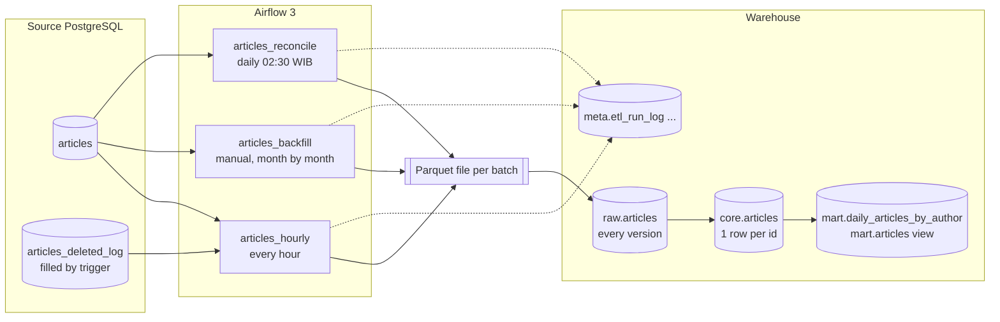

# kumparan articles ELT

An hourly ELT pipeline that moves the `articles` table from an OLTP database
(PostgreSQL) into a warehouse (PostgreSQL here, BigQuery design in
[docs/bigquery.md](docs/bigquery.md)), orchestrated by Airflow 3.

It covers the main task and both bonuses:

| Requirement | Where |
| --- | --- |
| ETL/ELT from a database to a warehouse | `pipeline/`, `warehouse_db/init.sql` |
| Runs every hour | `dags/articles_hourly.py` |
| Bonus 1: data since 2016 | `dags/articles_backfill.py`, `pipeline/backfill.py` |
| Bonus 2: hard deletes kept in sync | trigger log in `source_db/init.sql` + daily `dags/articles_reconcile.py` |

Design decisions and the alternatives that were rejected are in
[DECISIONS.md](DECISIONS.md). How AI was used is in [AI_USAGE.md](AI_USAGE.md).

---

## Quick start

Requirements: Docker with ~4 GB RAM for containers, and `make` (on Windows, use WSL2).

```bash
make up          # build + start: source DB, warehouse DB, Airflow (http://localhost:8080, airflow/airflow)
make seed        # ~100k synthetic articles from 2016 until now
make test        # 20 tests against separate test databases
```

Then in the Airflow UI:

1. Unpause **articles_hourly**. It starts with the most recent complete hour.
2. Trigger **articles_backfill** once. It refuses to start until `articles_hourly`
   has a successful run, because the hourly job must already be covering
   changes made while the history is copied (see Bonus 1).
3. Unpause **articles_reconcile** (daily, 02:30 WIB).

Try it by hand:

```bash
make simulate AT=2026-10-30T09:30:00Z                         # inserts, edits, soft + hard deletes at 09:30
make hourly START=2026-10-30T09:00Z END=2026-10-30T10:00Z     # same code path as the DAG
make report                                                   # run log, counts, busiest days
make psql-warehouse                                           # look around: raw, core, mart, meta
```

---

## Architecture



All three DAGs share one path: **extract → Parquet → raw → merge into core →
refresh mart → quality checks**. They only differ in how they choose rows
(an hour of changes, a month of history, or a list of ids). There is one
implementation of "how data lands correctly", not three.

---

## How the hourly run works

Task graph: `plan → extract → load → merge → refresh → quality → finish`.

**1. Which rows.** Each run owns its Airflow data interval `[start, end)` and
extracts:

```sql
WHERE (updated_at >= :start - 15 min AND updated_at < :end)
   OR (deleted_at >= :start - 15 min AND deleted_at < :end)
```

- **Half-open interval.** A row stamped exactly at 11:00:00 belongs to the
  11:00 run only. `BETWEEN` would put it in two runs.
- **`deleted_at` branch.** The schema says `updated_at` changes when an
  article is created or updated. Nothing says a soft delete touches it. The
  synthetic data does exactly that, and the test
  `test_soft_delete_that_does_not_touch_updated_at_is_captured` fails without this branch.
- **15-minute lookback.** In PostgreSQL `now()` is the transaction *start*
  time. A transaction that starts at 10:59:58 and commits at 11:00:03 is
  invisible to the 10:00 run, and its `updated_at` is before 11:00, so the
  11:00 run would skip it too. The lookback catches it.
  `test_late_commit_is_caught_by_the_lookback` and
  `test_without_lookback_the_late_commit_is_lost` show both sides.
  Read-replica lag has the same effect. 15 minutes is a starting value; in
  production it should come from the longest transaction and the replica lag actually observed.
- **Skipped hours.** With `catchup=False` Airflow does not create the runs
  missed while the scheduler was down; it only schedules the latest hour. The
  `plan` task looks up the end of the last successful window and, if there is
  a gap, this run reads from there (`test_a_skipped_hour_is_read_by_the_next_run`).
  No catch-up storm, no lost hours.
- **No `now()` in queries.** Bounds come from the data interval, so
  re-running last Tuesday 03:00 reads last Tuesday 03:00.
- **One snapshot.** Articles and delete tombstones are read in one
  `REPEATABLE READ, READ ONLY` transaction with a statement timeout, through
  a server-side cursor (no full result in memory), as a read-only role.

**2. Load.** Parquet, not CSV: `content` contains commas, quotes, newlines
and emoji (`test_awkward_text_survives_the_round_trip`). The batch's rows in
`raw` are deleted and re-inserted in one transaction, so a retry replaces the
batch instead of duplicating it. The batch id comes from the interval
(`hourly__20261030T0900Z`), never from a random UUID.

**3. Merge into `core.articles`.**

- dedupe the batch (one row per id, newest version first)
- upsert, with a version guard: update only if
  `(updated_at, deleted_at)` from the batch is **strictly newer** than what
  core has. Replaying an old batch cannot overwrite newer data
  (`test_an_older_version_never_overwrites_a_newer_one`), and a re-run of the
  same hour writes nothing at all (`test_rerunning_a_window_changes_nothing`
  compares checksums of the whole table)
- apply hard-delete tombstones
- an advisory lock serialises the three DAGs' writes to core

**4. Mart.** `mart.daily_articles_by_author` is refreshed incrementally: only
the days a batch can affect are recomputed, and that includes the **old**
publish day of an article that was rescheduled
(`test_mart_is_correct_when_an_article_moves_to_another_day`). Days are
Asia/Jakarta days. `mart.articles` is a view for analysts: live articles
only, no article body, WIB columns ready.

**5. Quality checks** on the ids in the batch.

| Fails the run (no retry) | Warns (stored in the run log) |
| --- | --- |
| an id stored twice | `updated_at < created_at` |
| a batch row missing from core | `published_at < created_at` (legacy data) |
| core holding an older version than the batch | rows in the default partition |
| | volume below 10% of the same hour last week |
| | newest `updated_at` more than 3 h behind |

Wrong data does not retry: retries are for transient errors (network, lock
timeouts), so the quality task has `retries=0`. Every run writes counts,
duration and check results to `meta.etl_run_log`.

### The Airflow 3 schedule trap

`schedule="0 * * * *"` looks right but is wrong for this job in Airflow 3.
`[scheduler] create_cron_data_intervals` defaults to `False`
(`airflow/config_templates/config.yml` in 3.3.2), so a cron string becomes a
`CronTriggerTimetable`, where `data_interval_start == data_interval_end`. An
incremental query on that window returns zero rows every hour and every run
is green. The DAG therefore uses `CronDataIntervalTimetable` explicitly, the
`plan` task fails on an empty interval, and
`test_hourly_dag_uses_a_data_interval_timetable` checks both.

Related: with this timetable a manual run (or `airflow dags test <date>`)
processes the hour **ending** at the given time. `dags test articles_hourly 2026-10-30T02:00:00+00:00`
loads 01:00-02:00.

---

## Data model

| Table | Grain | Notes |
| --- | --- | --- |
| `raw.articles` | one row per extracted version per batch | append-only per batch, replayable |
| `raw.article_hard_deletes` | one row per tombstone per batch | |
| `core.articles` | one row per article | partitioned by month of `created_at`; `is_deleted` = soft or hard deleted |
| `mart.daily_articles_by_author` | WIB day × author | live articles only |
| `mart.articles` (view) | one row per live article | no `content`, WIB columns |
| `meta.etl_run_log` | one row per batch | status, attempts, counts, quality JSON |
| `meta.backfill_state`, `meta.backfill_checkpoint` | | T0 and per-month progress |
| `meta.reconcile_result` | batch × month | what reconciliation found |

**Why partition by `created_at` and not `published_at`?** `created_at` is
never NULL and never changes, so a row never moves partition. `published_at`
is NULL for drafts and changes when a story is rescheduled. Analysts' date
filters go through `published_at`, which is indexed (and would be a
clustering column in BigQuery).

---

## Bonus 1: the data goes back to 2016

Things to consider, and what this repo does about each:

1. **Volume.** The brief says hundreds of thousands to over a million
   articles a day. At ~500k/day on average for ~10 years that is in the
   order of 1.8 billion rows, and with article bodies, terabytes. One
   `SELECT *` is not an option.
2. **Do not use `catchup` on the hourly DAG.** `start_date=2016` plus
   `catchup=True` creates ~94,000 hourly runs. A separate DAG processes
   ~130 monthly chunks instead.
3. **Chunking.** One chunk = one month of `created_at`. `created_at` never
   changes, so each row is in exactly one chunk.
4. **Load on the source.** Two months in parallel
   (`max_active_tis_per_dagrun=2`), read-only role, statement timeout. In
   production this reads from a replica or, better, from a snapshot/export,
   off-peak.
5. **Resumable.** `meta.backfill_checkpoint` marks finished months; a re-run
   skips them (`test_backfill_loads_history_is_resumable_and_validates`).
6. **Hand-over to the hourly job.** T0 is taken from the **source** clock
   when the backfill is planned. Anything changed after a month is copied
   must be picked up by the hourly job, so the plan refuses to start unless
   `articles_hourly` already has a successful window starting at or before
   T0 (`test_backfill_refuses_to_start_before_the_hourly_job_covers_t0`).
   Overlap between the two is harmless because the merge is idempotent and
   version-guarded.
7. **Validation.** After the months are loaded, row count and id checksum
   are compared per month, source vs warehouse.
8. **Dirty history.** Drafts without `published_at`, legacy rows published
   before they were created, odd timestamps: loaded as they are, counted by
   warn-level checks, never silently dropped.
9. **Partition limits and cost.** ~130 monthly partitions here. On BigQuery,
   daily partitions since 2016 are ~3,950 (the per-table limit is 10,000),
   and a single job may only touch a limited number of partitions, which is
   another reason to load month by month.

## Bonus 2: hard deletes

A watermark query can only find rows that exist. After a hard `DELETE` there
is nothing left to find, so the warehouse would show the article forever.
There are three ways to learn about deletes:

| Option | Delete time | Source change | Operational cost |
| --- | --- | --- | --- |
| Log-based CDC (WAL → Debezium/Datastream) | exact, near real time | `wal_level=logical` + replication slot | high; an unread slot keeps WAL and can fill the primary's disk |
| Trigger writing tombstones | exact | a table + trigger (needs the DB owners' approval) | low |
| Reconciliation (compare ids) | when detected | none | one aggregate query per side per day |

**Implemented:** trigger + reconciliation as two layers.

- `articles_deleted_log` is filled by a statement-level `AFTER DELETE` trigger
  (one insert per statement, not per row). The hourly run reads it in the same
  window and snapshot as the articles and sets `hard_deleted_at` in core.
  Every merge also applies tombstones stored earlier for the ids it loads: a
  backfill snapshot taken before a delete can be merged after the delete was
  processed, and must not bring the article back
  (`test_tombstone_that_arrives_before_the_row_still_wins`).
- `articles_reconcile` runs daily and catches what bypasses the trigger
  (`TRUNCATE`, triggers disabled, rows deleted before the trigger existed). It
  compares `count(*)` and `sum(id)` per month on both sides. Only for months that
  differ, it streams the source ids (`COPY`) into a temp table in the warehouse
  and anti-joins both ways. Rows gone from the source are marked deleted;
  rows missing from the warehouse are re-extracted when there are at most
  `RECONCILE_MAX_HEAL` of them. Rows newer than the last hourly window are
  ignored because they may simply be in flight
  (`test_reconcile_finds_deletes_that_bypassed_the_trigger_and_heals_missing_rows`).

**What "sync" means here.** Deleted articles are **tombstoned**, not removed:
`hard_deleted_at` is set, `is_deleted` becomes true, and every mart excludes
them. Analysts see the same live set as the source, and the history needed
for "how many articles were taken down last month" survives. If an article
must be erased for legal reasons, a separate purge has to remove it from
`raw` and `core` too. That process is not part of this repo.

**In production** I would move to log-based CDC once the hourly batch is not
enough (lower latency, or delete volume too high for the trigger), and keep
reconciliation as the safety net.

---

## Validation and tests

`make test` runs 20 tests against real PostgreSQL databases (no mocks; most
of what can go wrong here is SQL behaviour):

- window: half-open bounds, lookback, empty window rejected, skipped hour recovered
- soft delete without `updated_at` change; late commit with and without lookback
- re-run produces an identical table (checksum); old batch cannot overwrite new
- duplicate versions in a batch; awkward text round trip
- hard delete via trigger; tombstone that arrives before the row; reconciliation of bypassed deletes and missing rows;
  in-flight rows not flagged
- mart equals a full recompute after an article moves days; WIB day boundaries
- backfill guard, resume after a crash, validation
- quality checks fail the run when the same id appears twice
- the DAG uses a data-interval timetable, and a plain cron string would not

### Measured run times

Measured on a 2 vCPU / 7 GB Linux machine, PostgreSQL 16, Airflow 3.3.2:

| Scenario | Rows | Time |
| --- | --- | --- |
| Backfill 2016-01 … 2026-10 (130 months) + validation | 300,000 articles (379 MB in the source) | 99 s, 0 months mismatched |
| One hour of activity at kumparan's average rate | 41,621 changed rows + 300 hard deletes | 8.4 s end to end |
| Re-running that same hour | 41,621 rows, 0 written | 5.6 s, table checksum unchanged |
| Daily reconciliation, nothing to fix | 300,000 articles | 0.9 s |

---

## Scale and cost

- **Average load**: 1,000,000 / 24 ≈ **41,700 rows per hour**. The measured hour
  above takes seconds, so the hourly budget has a lot of room. Peaks (breaking
  news) and edits to old articles add to this, which is why runs are timed and logged.
- **What breaks first at 10× (~420k rows/hour)**: query load on the source and
  the merge. Answers, in order: read from a replica; split the extract by id
  range in parallel; shorter intervals (15 minutes); log-based CDC.
- **Backfill throughput** here is limited by per-batch overhead (under a
  second per month on average, mostly merge + mart refresh), not by row count. For billions of rows the history
  load should use the warehouse's native bulk path (Parquet on GCS +
  BigQuery load jobs, which are free of query charges) and build the mart
  once at the end instead of per month.
- **Warehouse cost (BigQuery)**: on-demand pricing charges bytes scanned. A
  `MERGE` without a partition filter would scan the whole table, including
  `content`, 24 times a day. [docs/bigquery.md](docs/bigquery.md) shows the
  merge restricted to the months present in the batch.

---

## Assumptions

1. `id` is a never-reused integer key. `created_at` never changes (it is the
   partition key; the quality check `no_duplicate_ids` fails the run if it does).
2. The application always sets `updated_at` on create and update. If some code
   path forgets, that change is invisible to any `updated_at` watermark. A
   database trigger setting `updated_at` (or CDC) removes the dependency.
3. Un-deleting an article (clearing `deleted_at`) also bumps `updated_at`.
4. Timestamps are `timestamptz`; everything is processed in UTC; WIB appears only in the mart.
5. Adding indexes, a read-only role and the delete trigger to the source is
   acceptable to the database owners (otherwise: CDC or reconciliation only).

## Known limitations / next steps

- Single-node PostgreSQL as a stand-in warehouse; BigQuery mapping documented, not deployed.
- `raw` keeps every version forever; production needs a retention policy (e.g. 90 days of raw).
- No SCD type 2 table yet. `raw` already holds every version, so
  "title as of date X" can be built from it.
- Schema changes in the source are not detected automatically. Today a new
  column is ignored; a dropped column fails the extract loudly.
- Alerts go to the log and, if configured, a Slack webhook; no SLA dashboard.
- The `authors` dimension was not part of the brief; in production it would be
  a small full-load table joined in the mart.

## Repository layout

```
dags/               articles_hourly, articles_backfill, articles_reconcile
pipeline/           extract, load, merge, mart, quality, backfill, reconcile, runlog, CLI
source_db/          source schema, delete trigger, seed + activity simulator
warehouse_db/       raw / core / mart / meta schema, partition helper
tests/              20 tests (pytest, real PostgreSQL)
docs/bigquery.md    the same design on BigQuery
DECISIONS.md        decisions, alternatives, things found while building
AI_USAGE.md         how AI was used
```
